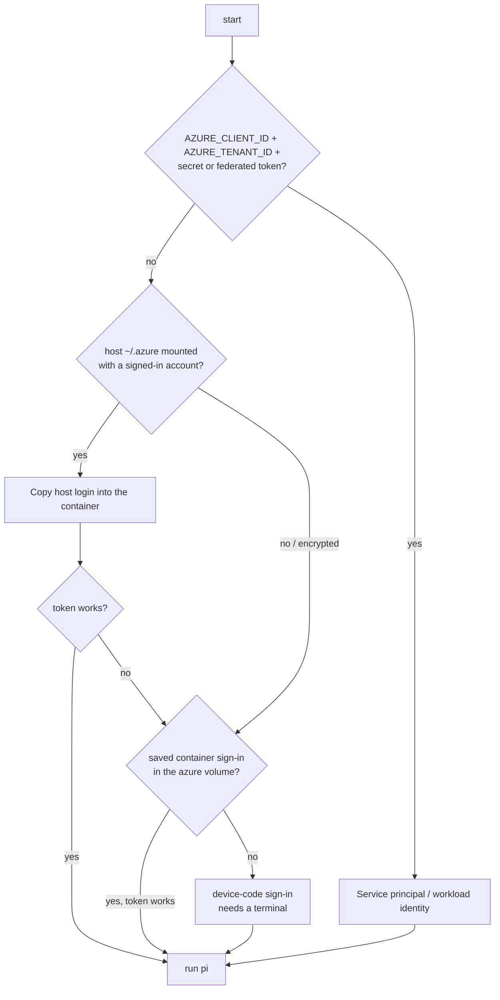
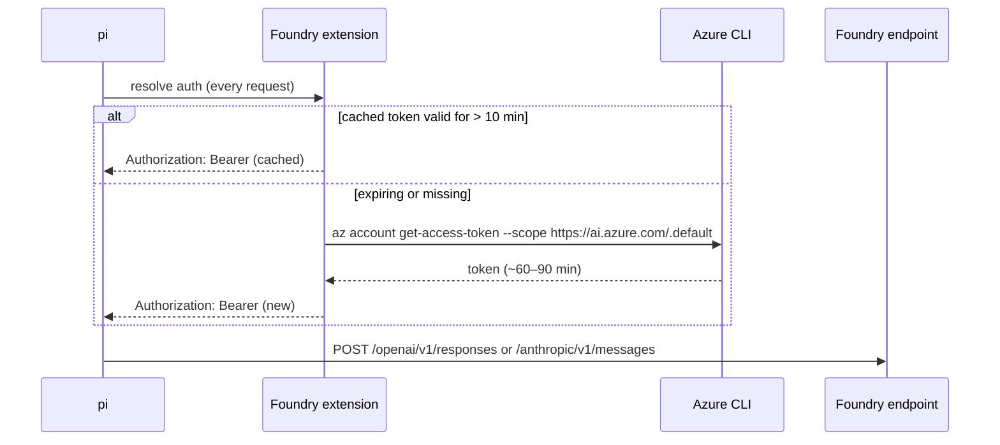

# Authentication

pi-foundry never uses API keys. Every model request carries a **Microsoft Entra ID access token** for the scope `https://ai.azure.com/.default`, obtained through the Azure CLI inside the container.

## How the identity is chosen

With `FOUNDRY_AUTH=auto` (the default), the first match wins:



Force a specific source with `FOUNDRY_AUTH`:

| `FOUNDRY_AUTH` | Source | Typical use |
|---|---|---|
| `auto` | as above | laptops and devboxes |
| `host` | your machine's `az login` (mounted `~/.azure`) | fail instead of falling back |
| `device-code` | sign-in stored in the `pi-foundry_azure` Docker volume | no az on the host, Windows hosts, separate identity for the agent |
| `service-principal` | `AZURE_CLIENT_ID` + `AZURE_TENANT_ID` + `AZURE_CLIENT_SECRET` **or** `AZURE_FEDERATED_TOKEN_FILE` | CI, GitHub Actions OIDC, AKS workload identity |
| `managed-identity` | the host's managed identity (`AZURE_CLIENT_ID` selects a user-assigned one) | Azure VMs, Container Apps, AKS |

## Host sign-in (default on macOS and Linux)

Your `~/.azure` is mounted **read-only** at `/host-azure` and **copied** into a private directory each time the container starts. pi-foundry never writes to your host Azure CLI state. Token refreshes inside the container use the copied refresh token and disappear when the container exits.

!!! warning "Windows hosts"
    On Windows the Azure CLI encrypts its token cache with DPAPI, which a Linux container can't read. pi-foundry detects this and falls back to a device-code sign-in. Run `pi-foundry login` once. Under WSL2 with az installed *inside* WSL, the host sign-in works normally.

## Device-code sign-in

```bash
pi-foundry login
# To sign in, use a web browser to open https://login.microsoft.com/device and enter the code ABCD1234
```

The sign-in is stored in the `pi-foundry_azure` named volume and refreshed automatically for as long as your tenant's refresh-token policy allows (typically 90 days of inactivity). With `FOUNDRY_AUTH=auto` a usable host sign-in still takes priority; set `FOUNDRY_AUTH=device-code` to always use the container identity.

Choose the tenant with `AZURE_TENANT_ID`, and the subscription used for discovery with `AZURE_SUBSCRIPTION_ID`.

## Service principal and workload identity

=== "Client secret"

    ```dotenv
    FOUNDRY_AUTH=service-principal
    AZURE_TENANT_ID=…
    AZURE_CLIENT_ID=…
    AZURE_CLIENT_SECRET=…
    ```

=== "Federated token (GitHub OIDC, AKS)"

    ```dotenv
    FOUNDRY_AUTH=service-principal
    AZURE_TENANT_ID=…
    AZURE_CLIENT_ID=…
    AZURE_FEDERATED_TOKEN_FILE=/var/run/secrets/azure/tokens/azure-identity-token
    ```

    Mount the token file into the container at that path (e.g. with a `compose.override.yaml`).

The principal needs the same role as a user: **Foundry User** or **Cognitive Services User** on the resource.

## Token lifecycle



- Tokens are refreshed **10 minutes before** they expire, so a long streaming response never outlives its token.
- Concurrent requests share one refresh.
- Transient network errors during refresh are retried. If refresh fails while the old token is still valid, the old token is used.
- The startup token is handed to pi through the environment and **removed from the environment** before any tool runs.
