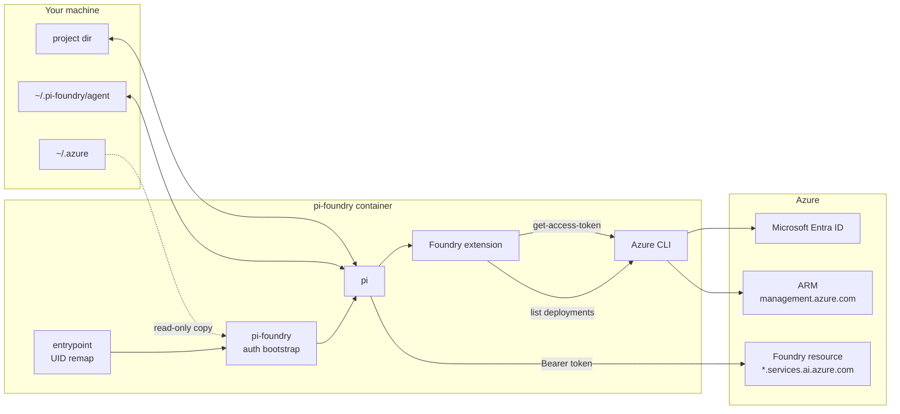

# How it works

## Startup

1. **`entrypoint.sh`** (root, briefly): matches the `pi` user's UID/GID to the owner of your project directory so files the agent writes belong to you, fixes ownership of the volumes, then drops privileges with `gosu`. Under rootless Docker/Podman it stays container-root, which is your host user.
2. **`pi-foundry`** picks an identity ([Authentication](authentication.md)), checks it by requesting a token, and starts `pi -e /opt/pi-foundry/extension`.
3. **The extension** loads before pi's UI starts:
    - reads `foundry.json` and `FOUNDRY_*` variables
    - **discovers** the resource and its deployments through ARM (`az cognitiveservices account deployment list`), cached for 10 minutes
    - **classifies** each deployment: `Anthropic` → Messages API at `/anthropic`; `OpenAI` with the `responses` capability → Responses API at `/openai/v1`; chat-only `OpenAI` → Chat Completions; embeddings/images/audio → skipped
    - looks up each model in **pi's built-in catalog** for context window, max output, reasoning levels, image input and pricing
    - registers one pi provider, **`foundry`**, with a per-request auth resolver
4. On session start, if you haven't chosen a model, it selects the strongest coding deployment.

## Requests

The `foundry` provider is a standard pi provider with an API **per model**: `openai-responses`, `anthropic-messages` or `openai-completions`. Auth is resolved **for every request** and returns only an `Authorization: Bearer …` header, so:

- No API key is ever configured, stored or sent (`api-key` / `x-api-key` headers are never used).
- Token refresh happens transparently between and during long agent runs.
- pi's normal retry, compaction, cost tracking and thinking-level features work unchanged.

## Why the Azure CLI?

- It already supports every identity type (user, device code, service principal, federated token, managed identity) and handles refresh tokens, MFA and conditional access.
- It lets the container reuse your host sign-in with no extra steps.
- It provides read-only ARM access for discovery.

The cost is image size (~1 GB) and about a second of startup for the first token. Tokens are cached in memory after that.

## Why `services.ai.azure.com/openai/v1`?

It's Azure's OpenAI-compatible **v1** surface: standard `Authorization: Bearer` auth, no `api-version` query parameter, and the same host serves the Anthropic endpoint. That means one token and one base host for every model family.

## Files in the image

| Path | |
|---|---|
| `/usr/local/bin/entrypoint.sh` | UID remap, privilege drop |
| `/usr/local/bin/pi-foundry` | auth bootstrap and subcommands |
| `/opt/pi-foundry/extension/index.ts` | the pi extension |
| `/opt/pi-foundry/lib/foundry.mjs` | config, token cache, discovery, model mapping |
| `/opt/pi-foundry/bin/foundry-doctor.mjs` | `doctor` and `models` |
